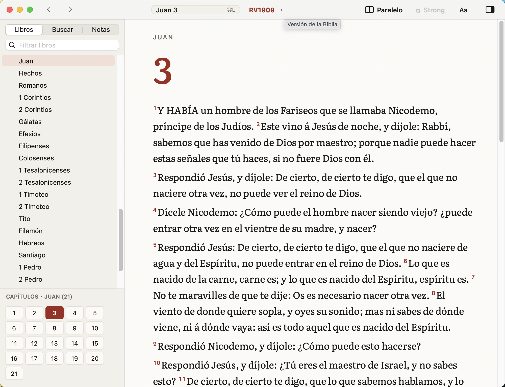
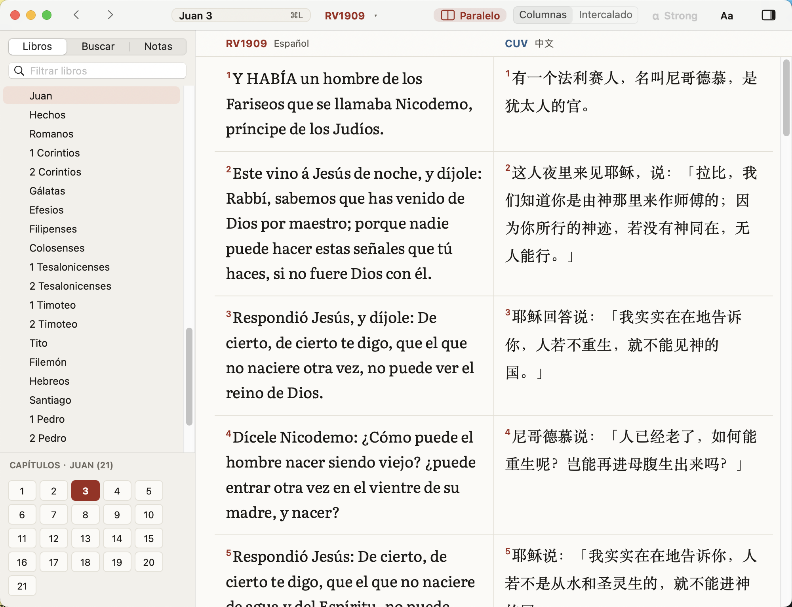
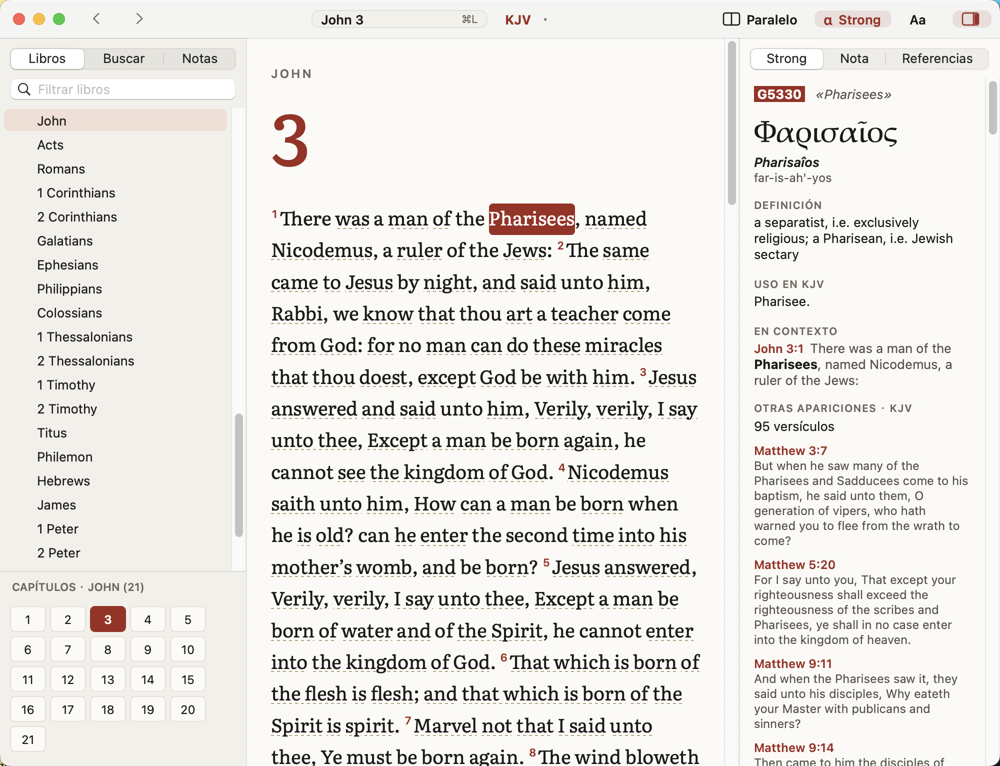

# Instalar Biblia Clásica

**Biblia Clásica** es la versión de Biblia para Mac antiguos: funciona en **macOS 10.13 (High Sierra) o posterior**, en Mac Intel y Apple Silicon (binario universal). Es gratuita, sin conexión, y no está en la App Store ni notarizada por Apple.

## ¿Biblia o Biblia Clásica?
| Tu Mac | Usa |
|---|---|
| macOS 14 (Sonoma) o posterior | **Biblia** (interfaz SwiftUI; ver [`INSTALAR.md`](INSTALAR.md)). También puedes usar Biblia Clásica. |
| macOS 10.13, 10.14, 10.15, 11, 12, 13 | **Biblia Clásica** |

Las dos apps tienen las mismas funciones de la versión 1.2 (lectura, ocho versiones, vista paralela y glosas, búsqueda, Strong, referencias cruzadas, historial, resaltados, marcadores y notas), el mismo diseño «Códice» y usan el mismo texto bíblico. Pueden estar instaladas a la vez; **cada una guarda sus datos por separado**.

### Cómo saber tu versión de macOS
Menú  (manzana, arriba a la izquierda) -> **Acerca de este Mac**. Verás «macOS High Sierra 10.13», «Mojave 10.14», «Catalina 10.15», «Big Sur 11», «Sonoma 14», etc.

## Instalación
1. Descarga `Biblia-Clasica-1.2.1.dmg` y haz doble clic para abrirlo.
2. Arrastra **Biblia Clásica** a la carpeta **Aplicaciones**.
3. **Primera apertura (solo una vez)**: en Aplicaciones, haz **clic derecho (o Control + clic) sobre Biblia Clásica -> Abrir**, y en el aviso pulsa **Abrir**.
4. Si el aviso no ofrece «Abrir»:
   - **macOS 10.13, 10.14 y 10.15**: intenta abrir la app normalmente (saldrá un aviso; pulsa Aceptar), ve a **Preferencias del Sistema -> Seguridad y privacidad -> General**, y junto al mensaje «"Biblia Clásica" se bloqueó porque no es de un desarrollador identificado» pulsa **Abrir de todos modos**. Confirma con **Abrir**.
   - **macOS 11 y posterior**: Preferencias/Ajustes del Sistema -> Privacidad y seguridad -> pulsa **Abrir igualmente**.

## Así se ve
**Lectura** — misma letra (Literata), colores y cabecera de capítulo que Biblia:

**Vista paralela en columnas** — con la barra de herramientas: referencia «⌘L», versión, Paralelo, Strong, Aa y panel lateral:

**Modo Strong** (KJV) — la palabra pulsada queda marcada y el panel derecho muestra el original:

## Actualizar
Cierra Biblia Clásica, descarga el DMG nuevo y arrastra la app a Aplicaciones, reemplazando la anterior. Tus datos se conservan. Puede que haya que repetir el paso del clic derecho -> Abrir.

## Desinstalar
Arrastra **Biblia Clásica** de Aplicaciones a la Papelera. Para borrar también tus datos, elimina `~/Library/Application Support/Biblia Clásica/` y `~/Library/Preferences/org.biblia.clasica.plist`.

## Dónde se guardan tus datos
- Historial, notas, resaltados y marcadores: `~/Library/Application Support/Biblia Clásica/user.sqlite`
- Ajustes: preferencias `org.biblia.clasica`.
- No se comparten con la app «Biblia» (que usa `~/Library/Application Support/Biblia/`). Para copiar tus notas de una a otra no hay importación automática.

## Diferencias respecto a Biblia 1.2.0
- Interfaz AppKit clásica (no SwiftUI) con el mismo diseño «Códice» (colores, letra Literata, columna de 640 pt, barra de herramientas con referencia ⌘L, Paralelo, Strong y Aa). Historial (⌘Y) y Versiones (⌥⌘V) están en los menús, igual que en Biblia.
- En la vista paralela en columnas, los números de versículo van dentro de cada columna (en Biblia comparten un margen común) y los resaltados se pintan por columna.
- **Tema oscuro**: en macOS 10.14 o posterior sigue la apariencia oscura del sistema; en **10.13** no existe modo oscuro del sistema, por lo que la app dibuja su propio tema oscuro (se elige en el menú Ver -> Tema).
- Usa su propia versión de SQLite (3.54, dominio público) incorporada, porque la del sistema en 10.13 no tiene búsqueda por trigramas.
- Datos de usuario y ajustes independientes (ver arriba). Pesa unos 125 MB (comprimido), el texto es el mismo.
- Algunas animaciones y detalles visuales de Biblia no existen en la versión clásica.

---

## 中文说明
**Biblia Clásica（经典版）**适用于 **macOS 10.13 (High Sierra) 及更高版本**，同时支持 Intel 和 Apple Silicon 芯片的 Mac。

### 选哪个版本？
- macOS 14 (Sonoma) 或更高：用 **Biblia**（也可用经典版）。
- macOS 10.13 – 13：用 **Biblia Clásica**。
- 查看系统版本：屏幕左上角苹果菜单 -> **关于本机**（Acerca de este Mac）。
- 两个应用功能相同（1.2 全部功能，同样的「Códice」新设计），可同时安装，**数据各自独立**。

### 安装
1. 打开 `Biblia-Clasica-1.2.1.dmg`，把 **Biblia Clásica** 拖到「应用程序」。
2. 第一次打开：在「应用程序」里**右键（或 Control+点击）Biblia Clásica -> 打开 -> 打开**。
3. 若没有"打开"按钮：
   - **macOS 10.13 / 10.14 / 10.15**：先正常双击打开一次（会被拦截），然后进入 **系统偏好设置 -> 安全性与隐私 -> 通用**，点击 **「仍然打开」**（西班牙语界面显示 **Abrir de todos modos**）。
   - **macOS 11 及以上**：系统设置 -> 隐私与安全性 -> **仍要打开**（Abrir igualmente）。
4. 更新：下载新 DMG 拖入「应用程序」替换旧版，数据保留。
5. 卸载：把应用拖进废纸篓；如需同时删除数据，删除 `~/Library/Application Support/Biblia Clásica/` 和 `~/Library/Preferences/org.biblia.clasica.plist`。

### 数据位置
`~/Library/Application Support/Biblia Clásica/user.sqlite`（历史、笔记、高亮、书签）；与 Biblia 应用的数据互相独立。

### 与 Biblia 的区别
- 界面使用 AppKit；暗色主题在 macOS 10.14 及以上跟随系统，**10.13 上使用应用自带的暗色主题**。
- 内置 SQLite 3.54（公有领域），经文内容相同。
