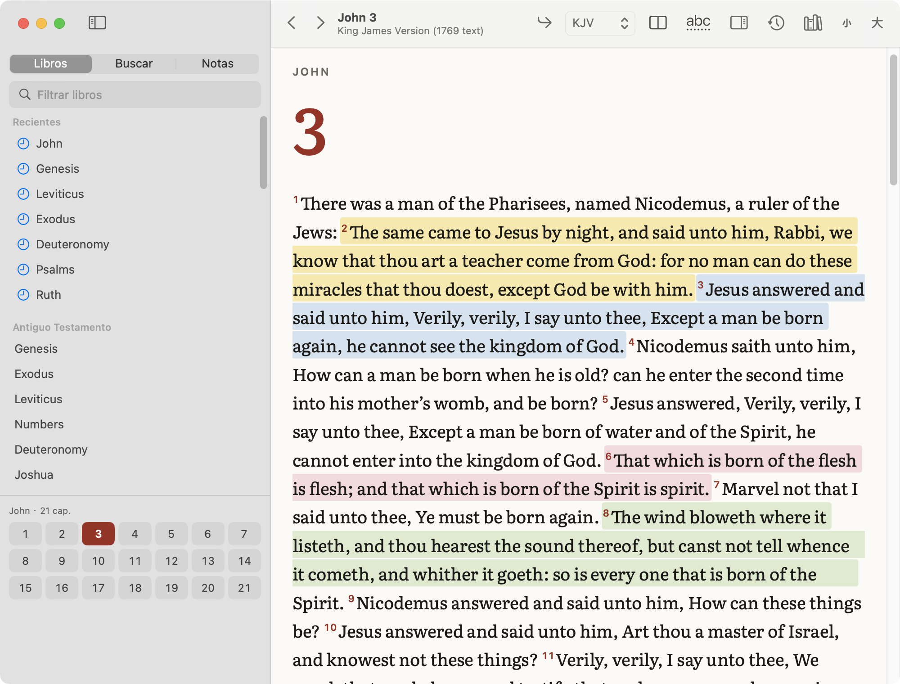
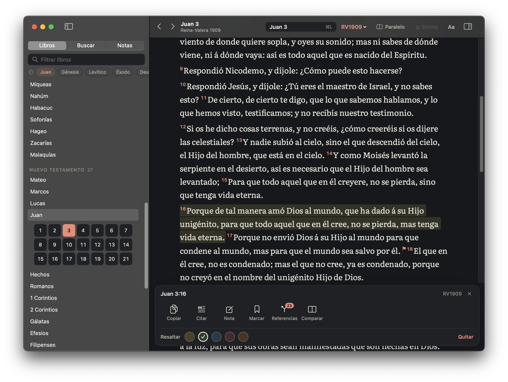
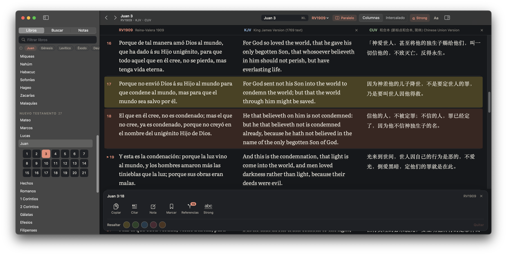
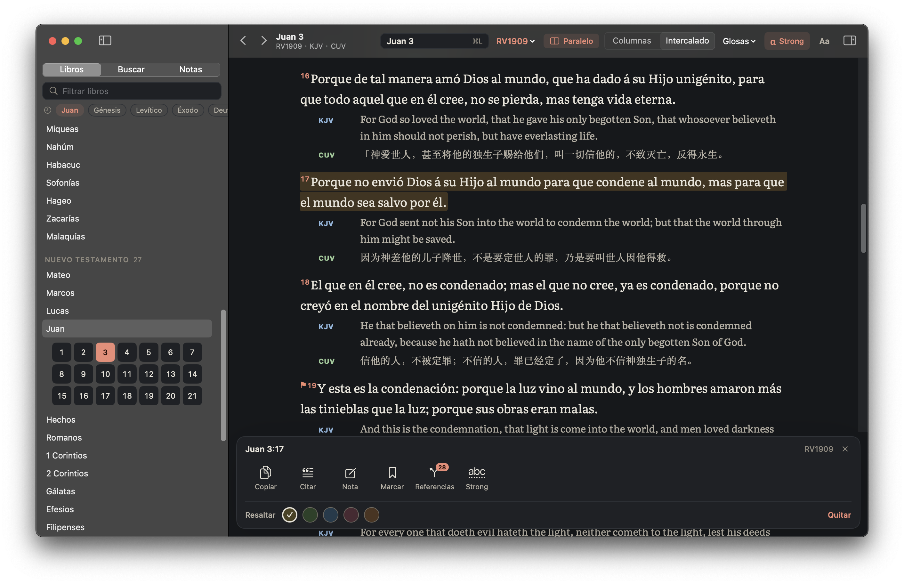
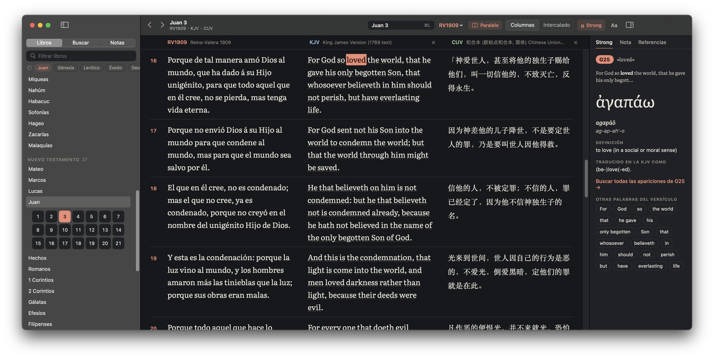
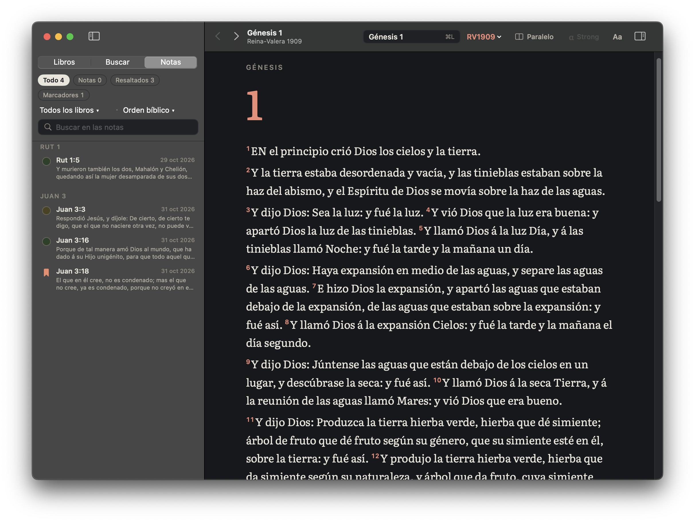

# Instalar Biblia

Biblia es gratuita y solo funciona en **macOS 14 (Sonoma) o superior**. No está en la App Store ni está notarizada por Apple, por eso la primera apertura requiere un paso extra.

## Instalación
1. Descarga `Biblia-1.2.0.dmg` y haz doble clic para abrirlo.
2. Arrastra **Biblia** a la carpeta **Aplicaciones**.
3. Primera apertura (solo una vez): abre Aplicaciones, haz **clic derecho (o Control + clic) sobre Biblia -> Abrir**, y en el aviso pulsa **Abrir**.
4. Si el aviso no ofrece "Abrir": intenta abrir la app normalmente, ve a **Ajustes del Sistema -> Privacidad y seguridad**, baja hasta el mensaje sobre "Biblia" y pulsa **Abrir igualmente** (te pedirá la contraseña).

## Así se ve
**Lectura** — el capítulo con su número grande, texto en Literata y números de versículo en rojo:

**Pulsar un versículo** abre la barra de acciones (copiar, citar, nota, marcar, referencias, comparar y los cinco colores):

**Vista paralela en columnas** — un resaltado cruza todas las columnas de la fila:

**Intercalado** — la versión principal y debajo las que elijas en «Glosas»:

**Modo Strong** (KJV) — pulsa una palabra subrayada para ver el original en el panel derecho:

**Panel Notas** — tus resaltados, marcadores y notas agrupados por capítulo:

## Actualizar
Cierra Biblia, descarga el DMG nuevo y arrastra la app a Aplicaciones, reemplazando la anterior. Tu historial, notas, resaltados y ajustes se conservan. Es posible que haya que repetir el paso del clic derecho -> Abrir.

## Novedades de la 1.2 (diseño «Códice»)
- **Nuevo aspecto**: icono de libro abierto con la cruz, colores más cálidos con el rojo como único acento, letra de lectura Literata (incluida en la app, funciona sin conexión), columna de texto más estrecha para leer mejor y temas claro, oscuro y sepia renovados.
- **Barra de herramientas**:
  - En el centro, la referencia actual («Juan 3 ⌘L»): púlsala para ir a cualquier pasaje. Al lado, la versión (en rojo) para cambiarla.
  - A la derecha: **Paralelo** (con «Columnas | Intercalado» cuando está activo), **Strong**, **Aa** (tema y tamaño de letra) y el panel lateral.
  - **Historial** y **Versiones** ya no están en la barra: búscalos en el menú **Leer** (⌘Y y ⌥⌘V).
- **Selección**: un clic marca un versículo y otro clic lo desmarca; puedes marcar varios a la vez. Esc o «Deseleccionar todo» (⇧⌘A) los quita todos.
- **Al final de cada capítulo**: enlaces «← capítulo anterior» y «capítulo siguiente →».
- **Barra lateral**: los libros recientes aparecen como etiquetas arriba; Antiguo y Nuevo Testamento se pueden plegar; la cuadrícula de capítulos sale bajo el libro elegido.
- **Ventanas pequeñas**: la app funciona desde 560 pt de ancho (la barra lateral se oculta sola).

## Novedades de la 1.1
- **Anotar un versículo**: pulsa el versículo y aparece la barra de acciones. También puedes hacer clic derecho o usar el menú «Versículo». Atajos: ⌥⌘C copiar con referencia, ⌥⌘H resaltar, ⌥⌘N anotar, ⌘D marcador.
- **Resaltar**: elige uno de los 5 colores de la barra («Quitar» lo borra). El resaltado se ve en todas las versiones y en las columnas de la vista paralela.
- **Notas**: «Anotar» abre la pestaña Nota del panel derecho (Markdown, vista previa, se guarda sola). Un lápiz junto al versículo indica que tiene nota.
- **Panel Notas**: en la barra lateral, pestaña «Notas» (junto a Libros y Buscar): lista de resaltados, marcadores y notas con filtros por tipo, color y libro, y búsqueda. Pulsa una fila para ir al versículo.
- **Referencias**: pestaña «Referencias» del panel derecho (o el botón de la barra): versículos relacionados, de más a menos votados; pulsa uno para ir allí.
- **Versiones nuevas** (gestor de versiones): 和合本繁體 (CUVT), Berean Standard Bible (BSB), World English Bible (WEB) y Biblia Libre (BLM, español).
- **Actualizar conserva tus datos**: tu historial, búsquedas y ajustes siguen donde estaban; la base de usuario se amplía sola con las tablas de notas, resaltados y marcadores la primera vez que abres la 1.1. La app ocupa unos 240 MB.

## Dónde se guardan tus datos
- Historial: `~/Library/Application Support/Biblia/user.sqlite`
- Ajustes: preferencias `org.biblia.lector` (`~/Library/Preferences/org.biblia.lector.plist`)
- Si venías de una versión de prueba (`org.bibliaapp.reader`, carpeta `BibliaApp`), al primer arranque se copian a las ubicaciones nuevas; las antiguas no se borran.

## Desinstalar
Arrastra Biblia de Aplicaciones a la Papelera. Para borrar también los datos, elimina la carpeta `~/Library/Application Support/Biblia` y el fichero de preferencias de arriba.

## 中文说明
1. 打开 DMG，把 Biblia 拖到「应用程序」。
2. 第一次打开：在「应用程序」里**右键（或 Control+点击）Biblia -> 打开 -> 打开**。
3. 若没有"打开"按钮：系统设置 -> 隐私与安全性 -> 找到 Biblia -> **仍要打开**。
4. 需要 macOS 14 或更高。更新：下载新版 DMG，拖入应用程序替换旧版，数据会保留。
5. 数据位置：`~/Library/Application Support/Biblia`。卸载：把应用拖进废纸篓（数据可另行删除）。

### 1.2 新功能（「Códice」新设计）
- **全新外观**：新图标（打开的书与十字架），以红色为唯一强调色，内置 Literata 阅读字体（离线可用），更舒适的文字栏宽度，浅色、深色和棕褐色主题全面更新。
- **工具栏**：中间显示当前经文（「Juan 3 ⌘L」），点击即可跳转到任意经文；旁边红色的版本名可切换版本。右侧依次为 **Paralelo**（对照，开启后可选「Columnas | Intercalado」）、**Strong**、**Aa**（主题和字号）以及侧边面板按钮。**历史记录**和**版本管理**移到「Leer」菜单（⌘Y、⌥⌘V）。
- **选择经文**：单击选中，再次单击取消；可同时选中多节。Esc 或「Deseleccionar todo」（⇧⌘A）全部取消。
- **章末导航**：每章末尾有「← 上一章」和「下一章 →」。
- **侧边栏**：最近阅读的书卷显示为标签；旧约、新约可折叠；章节网格显示在所选书卷下方。
- **小窗口**：窗口宽度最小可到 560 pt（侧边栏会自动隐藏）。
- 截图见上文（西班牙语部分）。

### 1.1 新功能
- **标注经文**：点击经文，出现操作栏（复制、带出处复制、笔记、书签、交叉引用、对照、Strong，以及 5 种高亮颜色）；也可右键或使用「Versículo」菜单。快捷键：⌥⌘C 带出处复制，⌥⌘H 高亮，⌥⌘N 笔记，⌘D 书签。
- **高亮**：在所有版本和对照栏中同步显示，「Quitar」可取消。
- **笔记**：右侧「Nota」标签页，支持 Markdown，自动保存；经文旁的铅笔图标表示有笔记。
- **笔记面板**：左侧栏第三个标签「Notas」，按类型、颜色、书卷筛选并可搜索，点击即可跳转。
- **交叉引用**：右侧「Referencias」标签页，按投票数排序，点击即可跳转。
- **新增版本**：和合本繁體 (CUVT)、BSB、WEB、西班牙语 Biblia Libre (BLM)。
- **更新不会丢失数据**：历史记录、搜索记录和设置全部保留；首次打开 1.1 时会自动为笔记、高亮和书签建表。应用约 240 MB。
