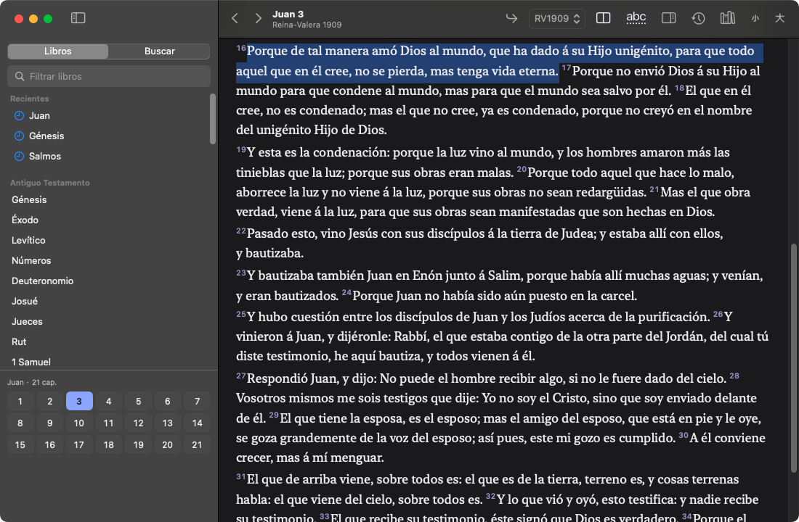
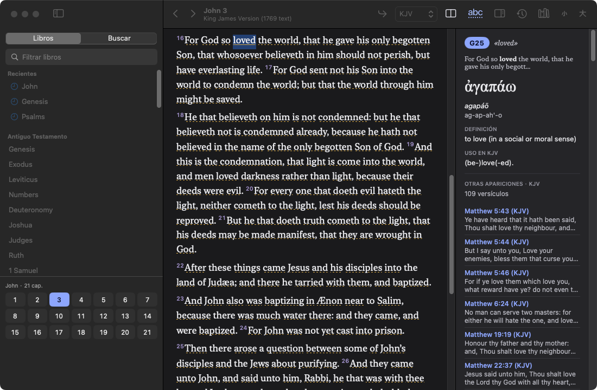
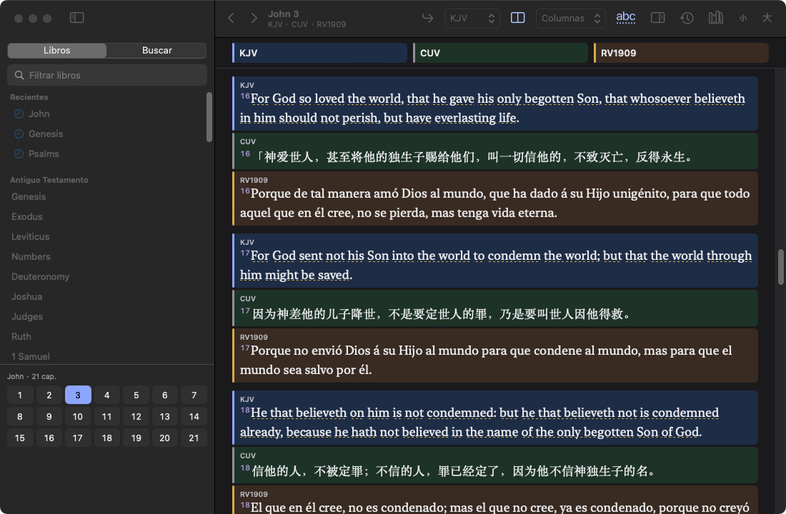

# Instalar Biblia

Biblia es gratuita y solo funciona en **macOS 14 (Sonoma) o superior**. No está en la App Store ni está notarizada por Apple, por eso la primera apertura requiere un paso extra.

## Instalación
1. Descarga `Biblia-1.0.0.dmg` y haz doble clic para abrirlo.
2. Arrastra **Biblia** a la carpeta **Aplicaciones**.
3. Primera apertura (solo una vez): abre Aplicaciones, haz **clic derecho (o Control + clic) sobre Biblia -> Abrir**, y en el aviso pulsa **Abrir**.
4. Si el aviso no ofrece "Abrir": intenta abrir la app normalmente, ve a **Ajustes del Sistema -> Privacidad y seguridad**, baja hasta el mensaje sobre "Biblia" y pulsa **Abrir igualmente** (te pedirá la contraseña).

## Actualizar
Cierra Biblia, descarga el DMG nuevo y arrastra la app a Aplicaciones, reemplazando la anterior. Tu historial y ajustes se conservan. Es posible que haya que repetir el paso del clic derecho -> Abrir.

## Dónde se guardan tus datos
- Historial: `~/Library/Application Support/Biblia/user.sqlite`
- Ajustes: preferencias `org.biblia.lector` (`~/Library/Preferences/org.biblia.lector.plist`)
- Si venías de una versión de prueba (`org.bibliaapp.reader`, carpeta `BibliaApp`), al primer arranque se copian a las ubicaciones nuevas; las antiguas no se borran.

## Desinstalar
Arrastra Biblia de Aplicaciones a la Papelera. Para borrar también los datos, elimina la carpeta `~/Library/Application Support/Biblia` y el fichero de preferencias de arriba.

## 中文说明
1. 打开 DMG，把 Biblia 拖到「应用程序」。
2. 第一次打开：在「应用程序」里**右键（或 Control+点击）Biblia -> 打开 -> 打开**。
3. 若没有"打开"按钮：系统设置 -> 隐私与安全性 -> 找到 Biblia -> **仍要打开**。
4. 需要 macOS 14 或更高。更新：下载新版 DMG，拖入应用程序替换旧版，数据会保留。
5. 数据位置：`~/Library/Application Support/Biblia`。卸载：把应用拖进废纸篓（数据可另行删除）。
